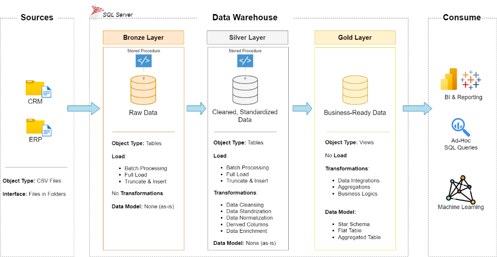
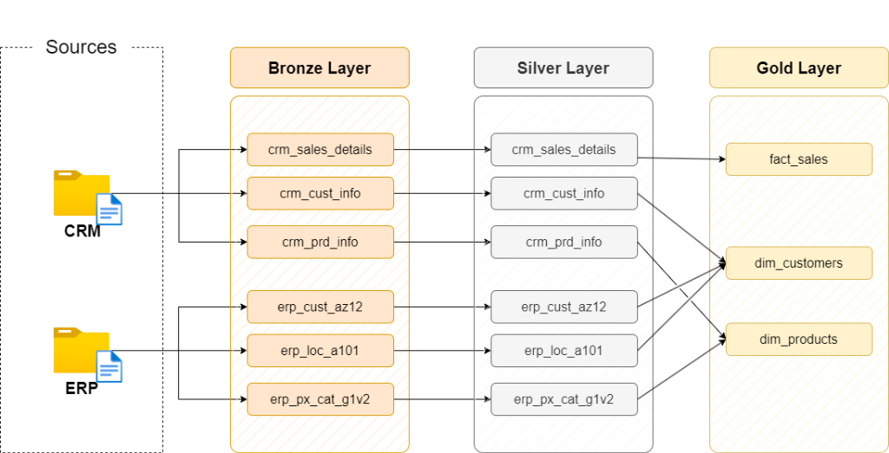
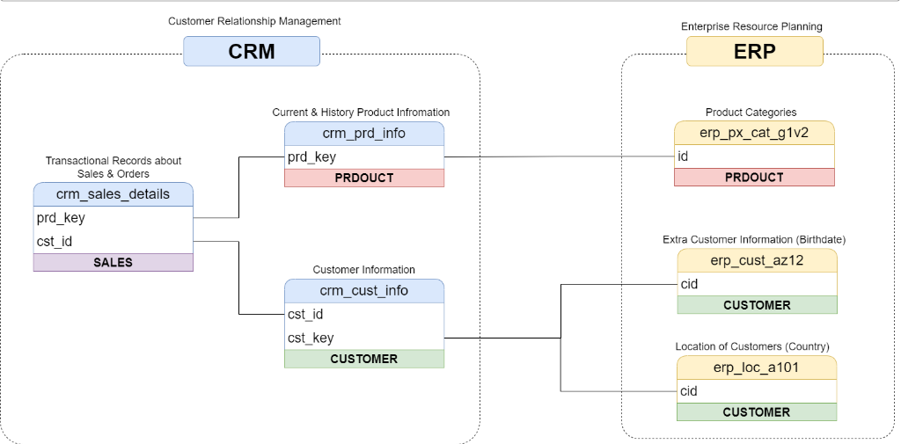
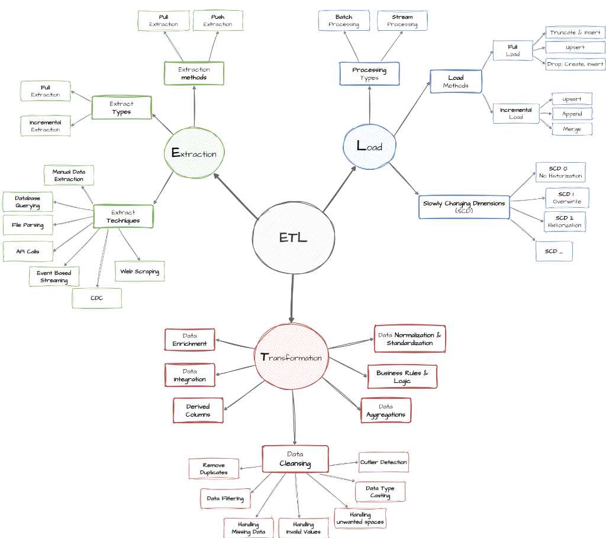
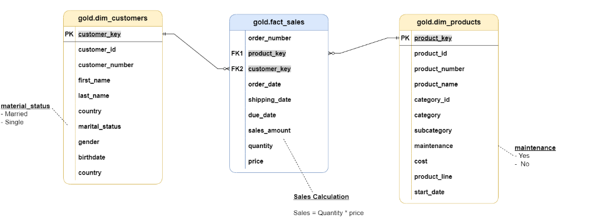

# 🏢 Modern SQL Data Warehouse & Analytics Engineering Project

[](https://www.microsoft.com/en-us/sql-server)
[](https://learn.microsoft.com/en-us/sql/t-sql/)
[-gold?style=for-the-badge)](#-data-architecture)
[-orange?style=for-the-badge)](#-dimensional-modeling--star-schema)
[](#-data-quality-assurance--testing)
[](LICENSE)

An enterprise-grade, end-to-end data warehousing and business intelligence solution built using **Microsoft SQL Server** and **T-SQL**. This project consolidates raw, disparate transactional data from two distinct source systems (**CRM** and **ERP**) through a structured **Medallion Architecture (Bronze ➔ Silver ➔ Gold)**. It delivers clean, modeled dimensional data marts optimized for analytical reporting, customer segmentation, product performance tracking, and executive decision-making.

---

## 📑 Table of Contents

- [Project Overview](#-project-overview)
- [System Architecture](#-system-architecture)
  - [High-Level Medallion Architecture](#high-level-medallion-architecture)
  - [Data Flow & Lineage](#data-flow--lineage)
  - [Cross-System Data Integration](#cross-system-data-integration)
  - [ETL Architecture & Techniques](#etl-architecture--techniques)
- [Source Datasets](#-source-datasets)
- [Data Pipeline Implementation](#-data-pipeline-implementation)
  - [1. Database Initialization](#1-database-initialization)
  - [2. Bronze Layer: Raw Ingestion](#2-bronze-layer-raw-ingestion)
  - [3. Silver Layer: Cleansing & Standardization](#3-silver-layer-cleansing--standardization)
  - [4. Gold Layer: Dimensional Modeling & Analytics](#4-gold-layer-dimensional-modeling--analytics)
- [Dimensional Modeling & Star Schema](#-dimensional-modeling--star-schema)
- [Analytical Reporting & Business Marts](#-analytical-reporting--business-marts)
  - [Customer Intelligence View (`gold.report_customers`)](#customer-intelligence-view-goldreport_customers)
  - [Product Performance View (`gold.report_products`)](#product-performance-view-goldreport_products)
- [Exploratory & Advanced Data Analysis](#-exploratory--advanced-data-analysis)
- [Data Quality Assurance & Testing](#-data-quality-assurance--testing)
- [Repository Structure](#-repository-structure)
- [Getting Started & Setup Guide](#-getting-started--setup-guide)
- [Standards & Documentation](#-standards--documentation)
- [Author & Acknowledgments](#-author--acknowledgments)

---

## 🎯 Project Overview

In real-world enterprise environments, business data is heavily siloed across disparate software applications—such as Customer Relationship Management (**CRM**) software and Enterprise Resource Planning (**ERP**) platforms. Each system tracks overlapping business entities using different keys, varying levels of data cleanliness, divergent date formats, and conflicting schemas.

This project delivers a **centralized SQL Data Warehouse** designed to:
1. **Consolidate Disparate Data Sources:** Ingest customer, product, and sales transaction data from both CRM and ERP systems.
2. **Automate High-Performance ELT/ETL:** Implement stored procedures with full execution tracking, timing metrics, and error handling (`TRY...CATCH`).
3. **Execute Comprehensive Data Cleansing:** Deduplicate records, normalize geographic and demographic codes, correct corrupted dates, and resolve financial discrepancies.
4. **Build Kimball-Style Dimensional Models:** Construct an intuitive Star Schema with dimension tables (`dim_customers`, `dim_products`) and a transactional fact table (`fact_sales`).
5. **Generate Actionable Business Intelligence:** Create aggregated reporting views and advanced analytical queries computing customer lifetime value, RFM segmentation, product sales velocity, and YoY growth trends.
6. **Enforce Strict Data Governance:** Implement automated data quality checks validating primary/surrogate keys, foreign key referential integrity, and business logic consistency.

---

## 🏗️ System Architecture

### High-Level Medallion Architecture

The warehouse follows the industry-standard **Medallion Architecture**, separating data processing into three distinct layers with progressively increasing data maturity:



| Layer | Type | Load Strategy | Primary Objective | Key Transformations |
| :--- | :--- | :--- | :--- | :--- |
| **Bronze Layer** | Physical Tables | Batch Full Load (`TRUNCATE & INSERT`) | Store unmodified raw data directly from source systems. | None (1:1 schema replication from source CSV files). |
| **Silver Layer** | Physical Tables | Batch Full Load via Stored Procedure | Clean, standardize, normalize, and enrich data for downstream consumption. | Data deduplication, whitespace trimming, date casting/validation, financial error reconciliation, metadata enrichment (`dwh_create_date`). |
| **Gold Layer** | SQL Views | On-demand query execution / Real-time | Serve business-ready Star Schema and aggregated analytical marts. | Dimensional modeling, surrogate key generation (`ROW_NUMBER()`), join resolution across CRM/ERP, metric aggregation, KPI derivation. |

---

### Data Flow & Lineage

The end-to-end data lineage traces each source entity through Bronze ingestion, Silver cleansing, and Gold dimensional consolidation:



- **Customer Lineage:**
  - `CRM: cust_info` (Primary demographics) + `ERP: CUST_AZ12` (Birthdate & Gender) + `ERP: LOC_A101` (Country) ➔ **`gold.dim_customers`**
- **Product Lineage:**
  - `CRM: prd_info` (Product catalogue, cost, line) + `ERP: PX_CAT_G1V2` (Category, Subcategory, Maintenance flag) ➔ **`gold.dim_products`**
- **Sales Lineage:**
  - `CRM: sales_details` (Orders, dates, volume, prices) ➔ **`gold.fact_sales`**

---

### Cross-System Data Integration

Because CRM and ERP originate from distinct software ecosystems, their keys require harmonization to establish proper relational integrity:



1. **Customer Integration:**
   - CRM customer identifiers (`cust_key`) link to ERP customer identifiers (`cid` in `erp_cust_az12` and `erp_loc_a101`).
   - Prefix cleaning: ERP IDs often prefix values with `'NAS'` (e.g., `'NAS12345'`) or embedded dashes (e.g., `'US-12345'`), which are normalized in the Silver layer to enable clean joins.
   - Master Data Resolution: CRM serves as the source of truth for name and marital status; missing gender or country values are enriched using ERP records.
2. **Product Integration:**
   - CRM product keys embed category identifiers within composite codes (e.g., `'CO-RD-...'`). The Silver procedure splits the string to extract `cat_id` and standardized `prd_key`, seamlessly joining ERP's product category hierarchy (`erp_px_cat_g1v2`).
3. **Sales Transactions:**
   - Orders in `crm_sales_details` connect to customer and product entities via clean foreign keys, feeding the centralized fact table.

---

### ETL Architecture & Techniques

The ETL design incorporates foundational data engineering best practices across Extraction, Transformation, and Loading:



- **Extraction:** Bulk ingestion of flat CSV files using SQL Server's native `BULK INSERT` with tablocks and second-row headers.
- **Transformation:**
  - *Data Cleansing:* Deduplication via window functions, trimming trailing/leading whitespace, invalid date identification, negative price correction.
  - *Data Normalization:* Standardizing codes (`'M'`/`'F'` ➔ `'Male'`/`'Female'`, `'USA'`/`'US'` ➔ `'United States'`).
  - *Derived Logic:* Computing end dates for slowly changing products using `LEAD()`, calculating lifespan, recency, and customer spend tiers.
- **Loading:** Automated batch processing inside transactional stored procedures (`bronze.load_bronze`, `silver.load_silver`) featuring runtime duration logging and detailed error handling.

---

## 📦 Source Datasets

The project processes six raw CSV datasets originating from two independent business systems:

| System | Dataset File | Description | Target Bronze Table | Record Grain |
| :--- | :--- | :--- | :--- | :--- |
| **CRM** | `datasets/source_crm/cust_info.csv` | Customer demographics, names, marital status, creation dates. | `bronze.crm_cust_info` | Customer ID |
| **CRM** | `datasets/source_crm/prd_info.csv` | Product catalogue, historical pricing, start/end dates. | `bronze.crm_prd_info` | Product ID / Key |
| **CRM** | `datasets/source_crm/sales_details.csv` | Transactional sales orders, line items, quantities, prices. | `bronze.crm_sales_details` | Sales Order Line Item |
| **ERP** | `datasets/source_erp/CUST_AZ12.csv` | Customer birth dates and supplemental gender classifications. | `bronze.erp_cust_az12` | Customer CID |
| **ERP** | `datasets/source_erp/LOC_A101.csv` | Geographic country mapping per customer. | `bronze.erp_loc_a101` | Customer CID |
| **ERP** | `datasets/source_erp/PX_CAT_G1V2.csv` | Category, subcategory, and maintenance classification. | `bronze.erp_px_cat_g1v2` | Category ID |

---

## ⚙️ Data Pipeline Implementation

### 1. Database Initialization
**Script:** [`scripts/init_database.sql`](scripts/init_database.sql)

Establishes a dedicated `DataWarehouse` database and provisions isolated schemas corresponding to the three architectural layers:
```sql
CREATE DATABASE DataWarehouse;
GO
USE DataWarehouse;
GO
CREATE SCHEMA bronze;
GO
CREATE SCHEMA silver;
GO
CREATE SCHEMA gold;
GO
```

---

### 2. Bronze Layer: Raw Ingestion
**DDL Script:** [`scripts/bronze/ddl_bronze.SQL`](scripts/bronze/ddl_bronze.SQL)  
**Stored Procedure:** [`scripts/bronze/proc_load_bronze.SQL`](scripts/bronze/proc_load_bronze.SQL)

The Bronze layer ingests raw files as-is without modifying values or enforcing rigid business rules.
- **Method:** `TRUNCATE TABLE` followed by `BULK INSERT`.
- **Operational Features:**
  - Tracks individual table execution durations and total batch elapsed time.
  - Comprehensive `TRY...CATCH` block printing detailed SQL error numbers, error states, and descriptive messages.

```sql
-- Execution example
EXEC bronze.load_bronze;
```

---

### 3. Silver Layer: Cleansing & Standardization
**DDL Script:** [`scripts/silver/ddl_silver.SQL`](scripts/silver/ddl_silver.SQL)  
**Stored Procedure:** [`scripts/silver/proc_load_silver.SQL`](scripts/silver/proc_load_silver.SQL)

The Silver layer serves as the data refinement engine, transforming messy raw data into trusted, verified tables:

#### Key Transformation & Cleansing Rules:
1. **Deduplication:**
   ```sql
   -- Identifies and retains only the most recent customer record
   SELECT * FROM (
       SELECT *, ROW_NUMBER() OVER (PARTITION BY cust_id ORDER BY cst_create_date DESC) AS flag_last
       FROM bronze.crm_cust_info
       WHERE cust_id IS NOT NULL
   ) t WHERE flag_last = 1;
   ```
2. **Whitespace Removal & Standardization:**
   - Trims unwanted spaces using `TRIM()` on customer names, descriptions, and categories.
   - Standardizes marital status: `'M'` ➔ `'Married'`, `'S'` ➔ `'Single'`, otherwise `'n/a'`.
   - Standardizes gender across both CRM and ERP sources: `'M'`, `'MALE'` ➔ `'Male'`; `'F'`, `'FEMALE'` ➔ `'Female'`; otherwise `'n/a'`.
3. **Product Hierarchy Parsing:**
   - Extracts category code from composite product keys (`REPLACE(SUBSTRING(prd_key, 1, 5), '-', '_')`).
   - Normalizes product lines: `'M'` ➔ `'Mountain'`, `'R'` ➔ `'Road'`, `'S'` ➔ `'Other Sales'`, `'T'` ➔ `'Touring'`.
   - Derives effective end dates using window function:
     ```sql
     CAST(LEAD(prd_start_dt) OVER (PARTITION BY prd_key ORDER BY prd_start_dt ASC) - 1 AS DATE) AS prd_end_dt
     ```
4. **Date Integrity & Outlier Correction:**
   - Validates integer-encoded dates (`sls_ord_dt`, `sls_ship_dt`, `sls_due_dt`), converting valid 8-digit values (`YYYYMMDD`) to `DATE` and converting zero/invalid values to `NULL`.
   - Rejects future birthdates (`bdate > GETDATE() ➔ NULL`).
5. **Financial Re-computation:**
   - Recalculates total sales when null, negative, or inconsistent with volume:
     ```sql
     CASE 
         WHEN sls_sales IS NULL OR sls_sales < 0 OR sls_sales != sls_quantity * ABS(sls_price)
         THEN sls_quantity * ABS(sls_price)
         ELSE sls_sales
     END AS sls_sales
     ```
   - Derives missing unit prices: `sls_sales / NULLIF(sls_quantity, 0)`.
6. **Metadata Audit Trail:**
   - Adds `dwh_create_date DATETIME2 DEFAULT GETDATE()` across all Silver tables.

```sql
-- Execution example
EXEC silver.load_silver;
```

---

### 4. Gold Layer: Dimensional Modeling & Analytics
**DDL Script:** [`scripts/gold/ddl_gold.sql`](scripts/gold/ddl_gold.sql)

The Gold layer structures data into a Kimball Star Schema using optimized SQL Views.

---

## 🌟 Dimensional Modeling & Star Schema

The presentation layer is modeled around business processes into a classic **Star Schema**, ensuring lightning-fast aggregations and seamless compatibility with Power BI, Tableau, and Excel:



### Schema Breakdown

```
                             ┌────────────────────────┐
                             │   gold.dim_customers   │
                             ├────────────────────────┤
                             │ PK  customer_key       │
                             │     customer_id        │
                             │     customer_number    │
                             │     first_name         │
                             │     last_name          │
                             │     country            │
                             │     birthdate          │
                             │     gender             │
                             │     marital_status     │
                             │     create_date        │
                             └───────────┬────────────┘
                                         │ 1
                                         │
                                         │ N
┌────────────────────────┐   N       ┌───┴────────────────────┐
│   gold.dim_products    ├───────────┤    gold.fact_sales     │
├────────────────────────┤ 1         ├────────────────────────┤
│ PK  product_key        │           │     order_number       │
│     product_id         │           │ FK  product_key        │
│     product_number     │           │ FK  customer_key       │
│     product_name       │           │     order_date         │
│     category_id        │           │     shipping_date      │
│     category_name      │           │     due_date           │
│     subcategory_name   │           │     sales              │
│     maintenance        │           │     quantity           │
│     product_cost       │           │     price              │
│     product_line       │           └────────────────────────┘
│     product_start_date │
└────────────────────────┘
```

#### 1. `gold.dim_customers`
- **Grain:** One row per unique customer.
- **Keys:** Surrogate Primary Key `customer_key` generated via `ROW_NUMBER()`.
- **Enrichment:** Merges CRM customer profile with ERP country (`LOC_A101`) and birthdate (`CUST_AZ12`), applying master-data precedence to gender resolution.

#### 2. `gold.dim_products`
- **Grain:** One row per active product offering.
- **Keys:** Surrogate Primary Key `product_key`.
- **SCD Handling:** Filters on `prd_end_dt IS NULL` to ensure downstream reporting reflects currently active product versions.
- **Hierarchy:** Normalizes Category ➔ Subcategory ➔ Product Name.

#### 3. `gold.fact_sales`
- **Grain:** One row per sales order line item.
- **Foreign Keys:** `customer_key` and `product_key` connecting directly to the dimension tables.
- **Measures:** `sales` (total monetary amount), `quantity` (units purchased), `price` (unit price).

---

## 📊 Analytical Reporting & Business Marts

To directly serve business analysts and executive dashboards, the Gold layer includes two pre-built analytical reporting views:

### Customer Intelligence View (`gold.report_customers`)
Consolidates lifetime customer metrics, RFM-style recency, spending habits, and demographic segments:

- **Customer Metrics:** Total orders, lifetime sales, total quantity, distinct products purchased, first & last order dates.
- **Lifespan & Recency:** Customer tenure in months (`lifespan`) and dormancy period (`recency`).
- **Valuable KPIs:** Average Order Value (`AOV = tot_sales / tot_orders`), Average Monthly Spend (`tot_sales / lifespan`).
- **Behavioral Segmentation:**
  - 🥇 **VIP:** Lifetime spend > $5,000 with $\ge$ 12 months history.
  - 🥈 **Regular:** Lifetime spend $\le$ $5,000 with $\ge$ 12 months history.
  - 🥉 **New:** Customer tenure < 12 months.
- **Demographic Cohorts:** Categorized into age groups (`Below 20`, `20-29`, `30-39`, `40-49`, `Above 50`).

### Product Performance View (`gold.report_products`)
Provides 360-degree product visibility to support inventory management and marketing strategy:

- **Volume & Revenue Metrics:** Total orders, total revenue, units sold, distinct buyer count.
- **Financial KPIs:** Average Selling Price (`ASP`), Average Order Revenue (`AOR`), Average Monthly Revenue.
- **Sales Velocity:** Product active lifespan and recency (months since last sale).
- **Performance Tiers:**
  - 🚀 **High Performance:** Generated > $50,000 in total sales.
  - ⚖️ **Mid-Range:** Generated between $10,000 and $50,000.
  - ⚠️ **Low Performance:** Generated < $10,000 in total sales.

---

## 🔍 Exploratory & Advanced Data Analysis

The warehouse includes production-ready analytical SQL scripts showcasing both fundamental and advanced SQL capabilities:

### 1. Exploratory Data Analysis (EDA)
**Script:** [`scripts/Exploratory_data_analysis.SQL`](scripts/Exploratory_data_analysis.SQL)

- **Database Profiling:** Inspects system schemas, object types, and column catalogs.
- **Metric Summaries:** Fast aggregation of core KPIs:
  ```sql
  SELECT 'Total Sales' AS measure_name, CAST(SUM(sales) AS DECIMAL(18,2)) AS measure_value FROM gold.fact_sales
  UNION ALL
  SELECT 'Total Items Sold', CAST(SUM(quantity) AS DECIMAL(18,2)) FROM gold.fact_sales
  UNION ALL
  SELECT 'Average Selling Price', CAST(AVG(price) AS DECIMAL(18,2)) FROM gold.fact_sales
  UNION ALL
  SELECT 'Total Orders', CAST(COUNT(DISTINCT order_number) AS DECIMAL(18,2)) FROM gold.fact_sales;
  ```
- **Magnitude & Distribution:** Revenue and customer distributions by country, gender, and product category.
- **Ranking Analysis:** Top 5 and bottom 5 products by revenue, top 10 highest-spending customers using `TOP`, `DENSE_RANK()`, and `ROW_NUMBER()`.

### 2. Advanced Business Analytics
**Script:** [`scripts/Advanced_exploratory_data_analysis.SQL`](scripts/Advanced_exploratory_data_analysis.SQL)

- **Sales Velocity Over Time:** Monthly and annual sales trends and customer volume.
- **Cumulative & Running Totals:** Calculating running sales totals and moving average prices over time using `SUM() OVER (...)`.
- **Year-over-Year (YoY) Growth Analysis:** Uses `LAG()` window function to contrast current product sales against previous years and overall product averages:
  ```sql
  LAG(current_sales) OVER (PARTITION BY product_name ORDER BY order_year ASC) AS prev_year_sales,
  current_sales - LAG(current_sales) OVER (PARTITION BY product_name ORDER BY order_year ASC) AS prev_year_diff_in_sales
  ```
- **Part-to-Whole Analysis:** Calculates the exact percentage contribution of each product category to total company revenue:
  ```sql
  CONCAT(ROUND((tot_sales / CAST(SUM(tot_sales) OVER() AS FLOAT)) * 100, 2), '%') AS percentage_of_tot_sales
  ```
- **Customer Spending Cohorts:** RFM behavioral clustering quantifying customer distribution across VIP, Regular, and New segments.

---

## 🛡️ Data Quality Assurance & Testing

Data reliability is guaranteed through automated SQL validation test scripts run post-load:

### Silver Layer Validation
**Script:** [`tests/quality_checks_silver.SQL`](tests/quality_checks_silver.SQL)

- ✅ **Uniqueness & Non-Null Checks:** Detects duplicate or null primary keys (`cust_id`, `prd_id`, `sls_ord_num`).
- ✅ **String Hygiene:** Identifies un-trimmed whitespace across text fields.
- ✅ **Domain Consistency:** Confirms discrete categorical values conform to standardized vocabularies.
- ✅ **Date Logic Verification:** Validates `prd_start_dt <= prd_end_dt` and `sls_ord_dt <= sls_ship_dt`.
- ✅ **Financial Reconciliations:** Flags any instance where `sls_sales != sls_quantity * sls_price` or where values are non-positive.
- ✅ **Join Capacity Tests:** Ensures foreign keys in ERP datasets cleanly map to CRM parent keys.

### Gold Layer Validation
**Script:** [`tests/quality_checks_gold.sql`](tests/quality_checks_gold.sql)

- ✅ **Surrogate Key Uniqueness:** Verifies zero duplicates in `customer_key` and `product_key`.
- ✅ **Referential Integrity:** Validates that every record in `gold.fact_sales` links cleanly to dimension tables with zero orphan keys:
  ```sql
  SELECT * FROM gold.fact_sales f
  LEFT JOIN gold.dim_customers c ON f.customer_key = c.customer_key
  LEFT JOIN gold.dim_products p ON f.product_key = p.product_key
  WHERE c.customer_key IS NULL OR p.product_key IS NULL;
  ```

---

## 📁 Repository Structure

```
sql-data-warehouse-project/
│
├── .gitignore                                # Git ignore rules (system files, DB files, IDE configs)
├── LICENSE                                   # MIT Open Source License
├── README.md                                 # Comprehensive project documentation
├── SETUP GUIDE - read me first.pdf           # Visual installation & environment setup guide
│
├── datasets/                                 # Raw data files (source inputs)
│   ├── source_crm/                           # Customer Relationship Management extracts
│   │   ├── cust_info.csv                     # Customer profile data
│   │   ├── prd_info.csv                      # Product catalog & pricing data
│   │   └── sales_details.csv                 # Sales transaction line items
│   └── source_erp/                           # Enterprise Resource Planning extracts
│       ├── CUST_AZ12.csv                     # Customer birthdate & demographic data
│       ├── LOC_A101.csv                      # Customer geographic location data
│       └── PX_CAT_G1V2.csv                   # Product category & maintenance classification
│
├── docs/                                     # Architecture documentation, diagrams & specifications
│   ├── data_architecture.png                 # High-level Medallion Architecture diagram
│   ├── data_flow.png                         # End-to-end data lineage diagram
│   ├── data_integration.png                  # CRM/ERP cross-system relationship diagram
│   ├── data_model.png                        # Kimball Star Schema diagram
│   ├── ETL.png                               # Comprehensive ETL strategy mindmap
│   ├── data_catalog.md                       # Gold layer data dictionary & column definitions
│   ├── naming_conventions.md                 # Object & column naming standards
│   ├── requirements.md                       # Business & functional engineering requirements
│   ├── Project_Requirements.pdf              # One-page executive requirements PDF
│   ├── data_layers.pdf                       # Deep dive into Medallion layer responsibilities
│   └── Project_Notes_Sketches.pdf            # Initial design drafts & engineering notes
│
├── scripts/                                  # Production SQL scripts
│   ├── init_database.sql                     # Database creation & schema setup (bronze, silver, gold)
│   ├── bronze/                               # Bronze layer scripts
│   │   ├── ddl_bronze.SQL                    # Table definition DDLs
│   │   └── proc_load_bronze.SQL              # Full-load stored procedure using BULK INSERT
│   ├── silver/                               # Silver layer scripts
│   │   ├── ddl_silver.SQL                    # Table definition DDLs with metadata columns
│   │   └── proc_load_silver.SQL              # Transformation, cleansing & deduplication procedure
│   ├── gold/                                 # Gold layer scripts
│   │   └── ddl_gold.sql                      # Star Schema views and analytical report marts
│   ├── Exploratory_data_analysis.SQL         # Descriptive statistics, profiling & ranking queries
│   └── Advanced_exploratory_data_analysis.SQL# Window functions, YoY trends, part-to-whole analysis
│
└── tests/                                    # Quality assurance & verification scripts
    ├── quality_checks_silver.SQL             # Cleansing & business rule validation tests
    └── quality_checks_gold.sql               # Star Schema referential integrity & key tests
```

---

## 🚀 Getting Started & Setup Guide

Follow this step-by-step walkthrough to reproduce the data warehouse on your local environment:

### Prerequisites
- **Database Engine:** Microsoft SQL Server (2019 or newer, Developer or Express Edition).
- **Client IDE:** [SQL Server Management Studio (SSMS)](https://learn.microsoft.com/en-us/sql/ssms/download-sql-server-management-studio-ssms) or [Azure Data Studio](https://learn.microsoft.com/en-us/azure-data-studio/download-azure-data-studio).
- *Mac Users:* Refer to [`SETUP GUIDE - read me first.pdf`](SETUP%20GUIDE%20-%20read%20me%20first.pdf) for instructions on running SQL Server inside a Docker container.

### Step-by-Step Deployment

#### 1. Clone the Repository
```bash
git clone https://github.com/YashK3086/sql-data-warehouse-project.git
cd sql-data-warehouse-project
```

#### 2. Initialize Database & Schemas
Open SSMS, connect to your SQL Server instance, open [`scripts/init_database.sql`](scripts/init_database.sql), and execute the script. This creates the `DataWarehouse` database and sets up the `bronze`, `silver`, and `gold` schemas.

#### 3. Deploy & Populate Bronze Layer
1. Open [`scripts/bronze/ddl_bronze.SQL`](scripts/bronze/ddl_bronze.SQL) and run it to create the 6 raw Bronze tables.
2. Open [`scripts/bronze/proc_load_bronze.SQL`](scripts/bronze/proc_load_bronze.SQL).
3. **Important:** Update the file paths inside the `BULK INSERT` statements to point to the absolute path where you cloned the `datasets/` directory on your machine:
   ```sql
   BULK INSERT bronze.crm_cust_info
   FROM 'C:\your_path\sql-data-warehouse-project\datasets\source_crm\cust_info.csv'
   WITH (FIRSTROW = 2, FIELDTERMINATOR = ',', TABLOCK);
   ```
4. Execute the script to create the procedure, then trigger the ingestion:
   ```sql
   EXEC bronze.load_bronze;
   ```

#### 4. Deploy & Populate Silver Layer
1. Open [`scripts/silver/ddl_silver.SQL`](scripts/silver/ddl_silver.SQL) and execute to create the Silver tables.
2. Open [`scripts/silver/proc_load_silver.SQL`](scripts/silver/proc_load_silver.SQL) and run it to create the cleansing procedure.
3. Execute the procedure to transform and populate cleaned records:
   ```sql
   EXEC silver.load_silver;
   ```

#### 5. Execute Silver Data Quality Tests
Open [`tests/quality_checks_silver.SQL`](tests/quality_checks_silver.SQL) and run the validation queries to verify that all duplicates, nulls, invalid dates, and string corruptions have been resolved.

#### 6. Build Gold Layer Views & Analytical Marts
Open [`scripts/gold/ddl_gold.sql`](scripts/gold/ddl_gold.sql) and execute the script to build:
- Dimension views: `gold.dim_customers`, `gold.dim_products`
- Fact view: `gold.fact_sales`
- Reporting marts: `gold.report_customers`, `gold.report_products`

#### 7. Verify Gold Model Integrity
Open [`tests/quality_checks_gold.sql`](tests/quality_checks_gold.sql) and execute to confirm 100% referential integrity across the Star Schema.

#### 8. Run Exploratory & Advanced Analytics
Run [`scripts/Exploratory_data_analysis.SQL`](scripts/Exploratory_data_analysis.SQL) and [`scripts/Advanced_exploratory_data_analysis.SQL`](scripts/Advanced_exploratory_data_analysis.SQL) to query business insights, customer segments, product rankings, and revenue trends.

---

## 📐 Standards & Documentation

For detailed specifications, consult the project documentation files in the [`docs/`](docs/) directory:
- 📖 [**Data Catalog**](docs/data_catalog.md): Detailed schema catalog, data types, and column definitions for all Gold layer objects.
- 🏷️ [**Naming Conventions**](docs/naming_conventions.md): Strict guidelines for `snake_case`, table prefixing (`dim_`, `fact_`, `report_`), surrogate key suffixing (`_key`), and technical audit metadata (`dwh_`).
- 📋 [**Project Requirements**](docs/requirements.md): Functional and technical requirements document.

---

## 👤 Author & Acknowledgments

- **Author:** **Yashvardhan Khanna**  
  GitHub: [@YashK3086](https://github.com/YashK3086)  
  Repository: [sql-data-warehouse-project](https://github.com/YashK3086/sql-data-warehouse-project)

Project developed following enterprise data engineering best practices and Kimball dimensional modeling principles.
